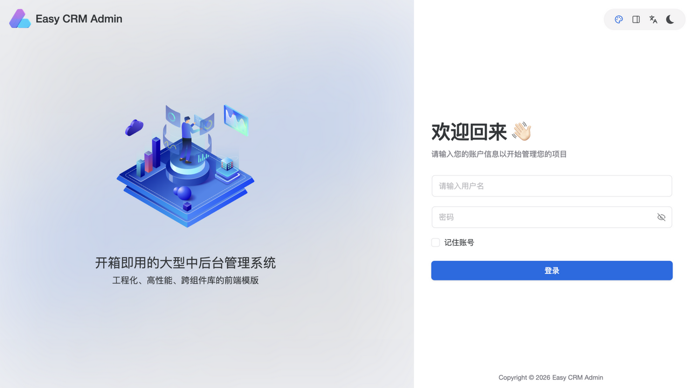
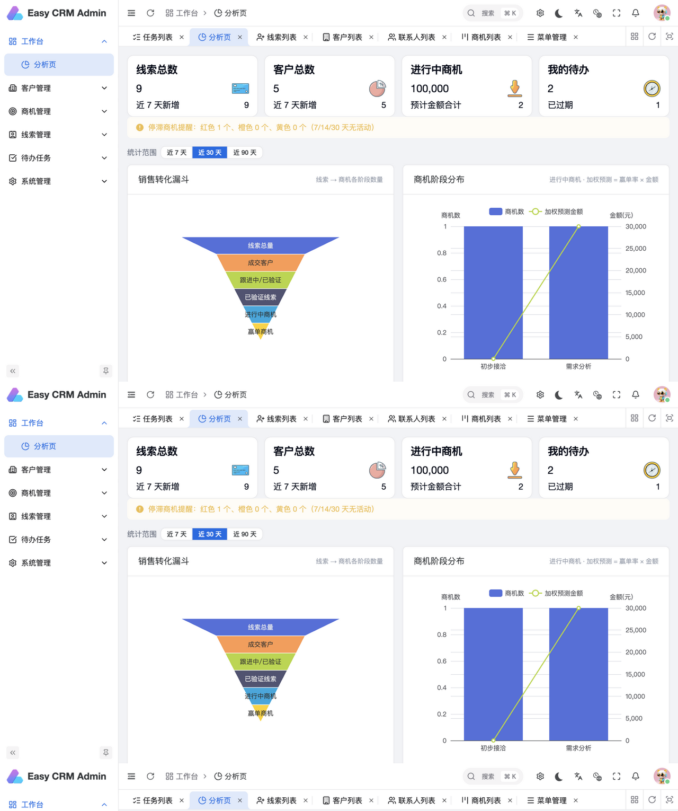
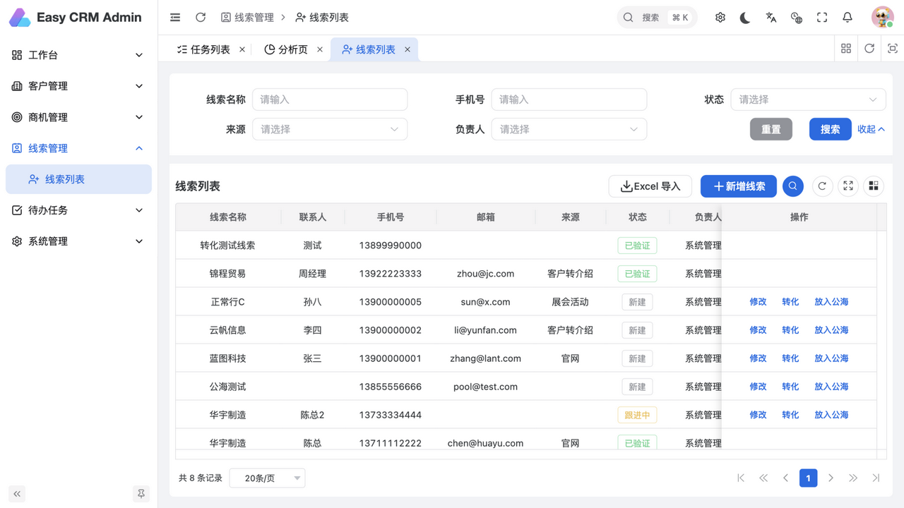
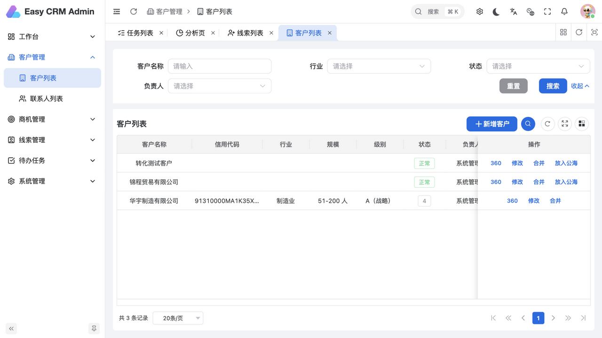
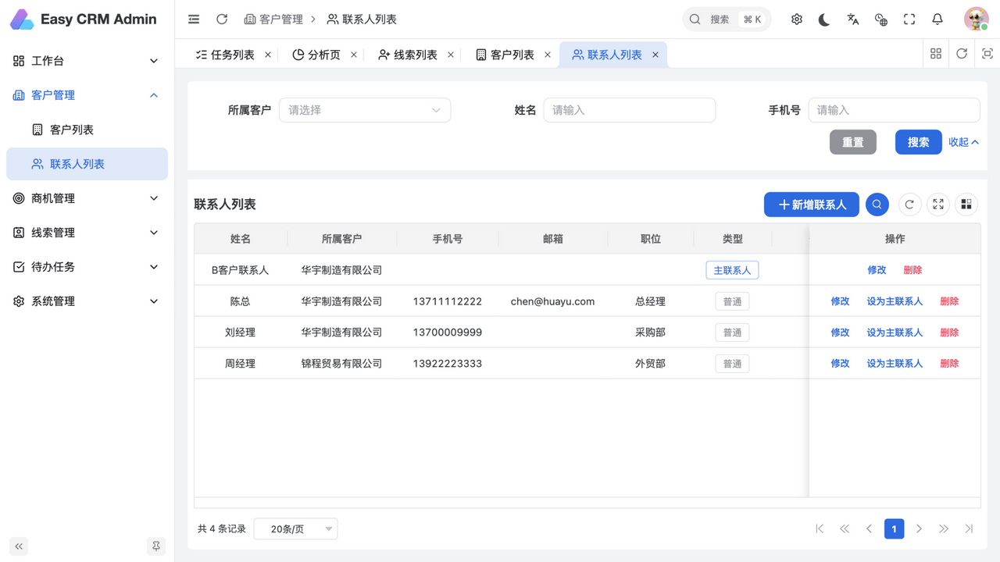
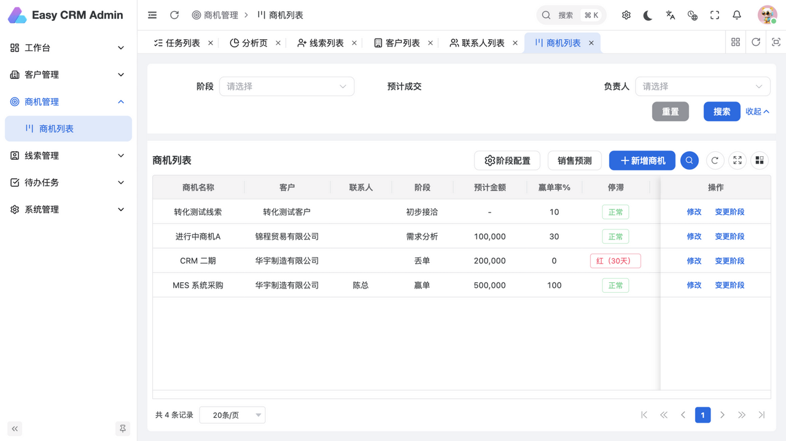
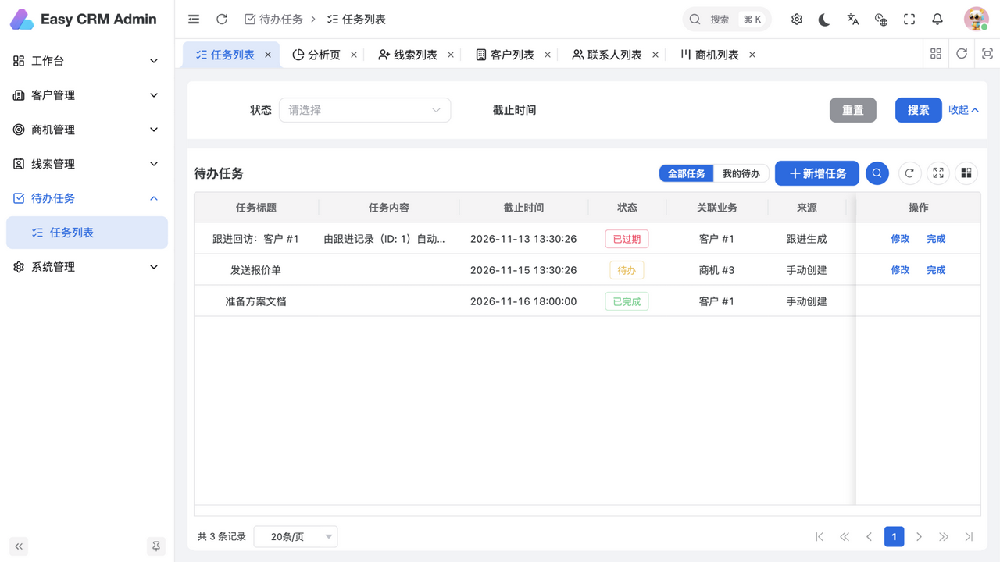
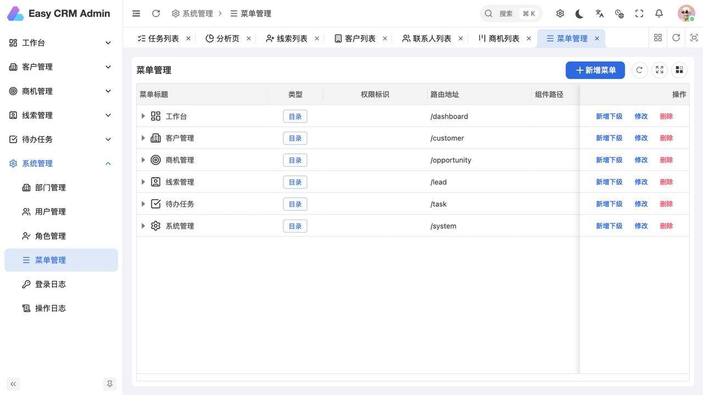

# easy-crm 通用 CRM 系统

前后端分离的通用 CRM：管理后台 RESTful API + Vue 3 前端，后续规划小程序端。

| 子项目 | 说明 | 技术栈 |
| --- | --- | --- |
| [backend/](backend/README.md) | 后端（单模块 + 按业务域分包），端口 8085（无 context-path，接口直挂根路径） | Java 25 · Spring Boot 4.1.2 · MyBatis-Plus 3.5.18 · MySQL 8.4 |
| [crm-web/](crm-web/README.md) | 管理后台前端 | Vben Admin 5.7.0（web-ele）· Vue 3 · Element Plus · pnpm monorepo |
| 小程序 | 待规划 | uni-app（参照 easy-mall miniprogram） |

## 目录结构

```
easy-crm/
├── backend/                    # 后端 Maven 工程（单模块，cn.easykits.crm）
│   ├── src/main/java/cn/easykits/crm/
│   │   ├── common/             # 统一响应 / 异常 / 登录上下文 / 行级数据权限 / 操作日志
│   │   ├── config/             # MyBatis-Plus 插件、Security、审计字段填充、Jackson 格式
│   │   ├── security/           # JWT 签发与认证过滤器、授权服务
│   │   ├── entity / mapper     # 实体与 Mapper（sys_* + crm_*）
│   │   └── modules/            # 业务模块：auth / system / lead / customer / contact / opportunity / follow / task / log
│   ├── db/init.sql             # 建表 + 初始数据（RBAC + 预置菜单 + admin 账号）
│   └── docs/…                  # 审查报告等
├── crm-web/                    # 前端（Vben Admin monorepo，应用在 apps/web-ele）
└── docs/                       # 审查报告 / 界面截图
```

## 界面预览

**管理后台**（Vben Admin · Vue 3 · Element Plus，动态菜单 + 按钮级权限）

| 登录 | 工作台 |
| :---: | :---: |
|  |  |
| **线索管理**（查重/公海/转化/Excel 导入） | **客户管理**（组合查重/合并/360 视图） |
|  |  |
| **联系人管理**（主联系人唯一） | **商机管理**（阶段配置/赢单率/停滞预警） |
|  |  |
| **待办任务**（跟进自动生成/过期预警） | **系统管理**（动态菜单 + 按钮权限） |
|  |  |

## 功能总览

| 模块 | 功能要点 |
| --- | --- |
| 工作台 | 分析页（数据看板） |
| 线索管理 | 独立潜在客户池；状态机（新建→跟进中→已验证，不合格）；手机号/邮箱查重；转化一键生成客户+联系人+商机（事务）；公海（手动放入/领取 + 15 天无跟进自动回收）；Excel 批量导入（逐行校验、错误行带行号返回） |
| 客户管理 | 已转化企业实体；名称+信用代码组合查重阻断；合并（联系人/线索关联迁移，事务）；客户公海（独立配置 30 天回收）；360 视图（基本信息+联系人，商机/跟进待接） |
| 联系人管理 | 挂载客户下；主联系人唯一（事务内先清后设）；随客户可见 |
| 商机管理 | 销售阶段可配置（独立表 + 默认 6 阶段）；阶段流转（终态不可变、赢单率冗余）；赢单回写成交信息 + 客户置为成交客户 + AFTER_COMMIT 事件；丢单必填原因；看板（一次查询全部分组）；销售预测（一条聚合 SQL）；停滞检测（7/14/30 天 黄/橙/红写提醒） |
| 跟进记录与待办 | 多态关联（线索/客户/商机）；跟进类型字典；自动生成下次跟进待办；时间线聚合（跟进+待办+阶段变更日志，一条 UNION 分页）；我的待办（3 天窗口/过期动态计算） |
| 系统管理 | 部门/用户/角色/菜单四级 RBAC + 动态路由下发；登录/操作日志；行级数据权限（本人/本部门/本部门及下级/全部，拦截器按表注入） |

## 当前进度

- [x] 后端基座：统一响应 / 异常 / JWT 认证（Spring Security） / MyBatis-Plus 插件 / 审计字段自动填充 / 行级数据权限拦截器
- [x] 系统管理：部门 / 用户 / 角色 / 菜单（动态路由 + 按钮权限码）、登录 / 操作日志、菜单配置已授权超管
- [x] 线索管理：状态机 / 查重 / 公海 / 转化（事务）/ Excel 导入（EasyExcel）
- [x] 客户与联系人：组合查重 / 合并（事务）/ 360 视图 / 主联系人唯一 / 公海
- [x] 商机管理：阶段配置 / 看板 / 预测聚合 / 停滞提醒 / 赢单事件（AFTER_COMMIT，轮次 5 接订单）
- [x] 跟进记录与待办：策略模式活动时间同步 / 时间线聚合（UNION 分页）/ 我的待办
- [x] 前端：Vben Admin（web-ele）各业务页面 + 动态菜单对接，截图见上方「界面预览」
- [ ] 订单 / 回款模块（赢单事件监听器已预留，轮次 5）
- [ ] 跟进记录表接入 360 视图与公海回收依据（轮次 4 后续）
- [ ] 字典表迁移（当前 LeadSource / CustomerDicts 等为常量类）
- [ ] 消息中心（待移植 easy-mall message 模块）

## 已具备（无需开发）

RBAC 表：sys_user、sys_role、sys_user_role、sys_permission、sys_role_permission；组织表：sys_dept。
后端只需提供 RESTful API，前端已有参考实现。

## 快速启动

```bash
# 后端（需 JDK 25）
cd backend
MYSQL_PASSWORD=xxx mvn spring-boot:run

# 前端（需 pnpm）
cd crm-web
pnpm install
pnpm dev
```
